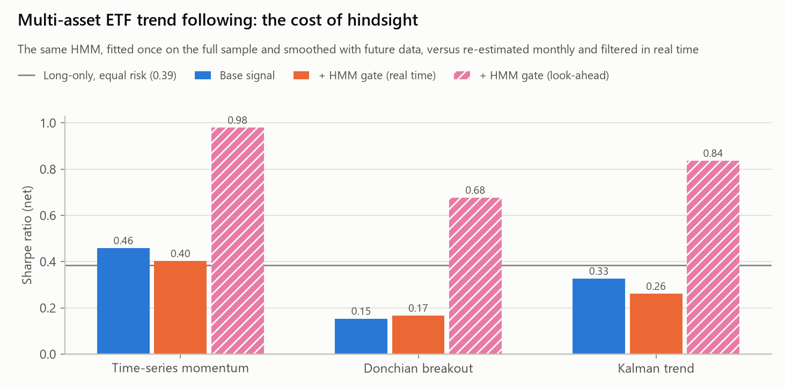
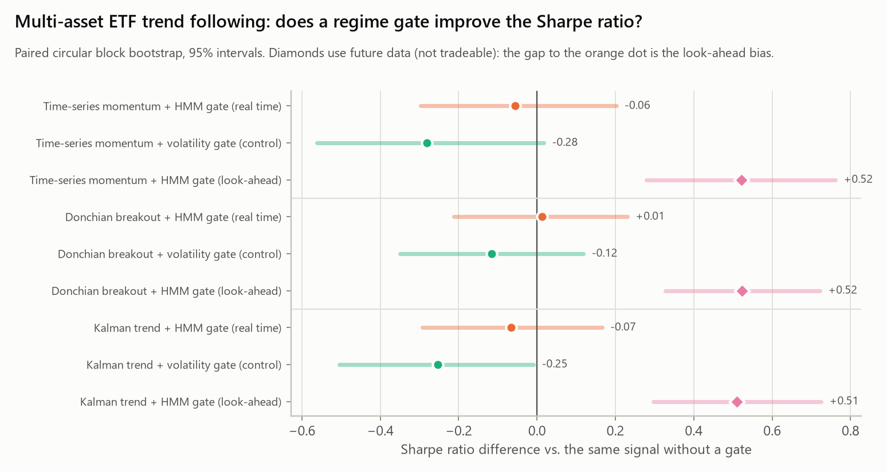
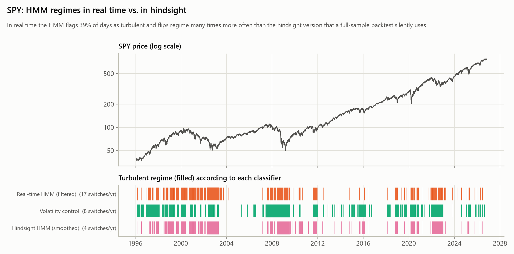
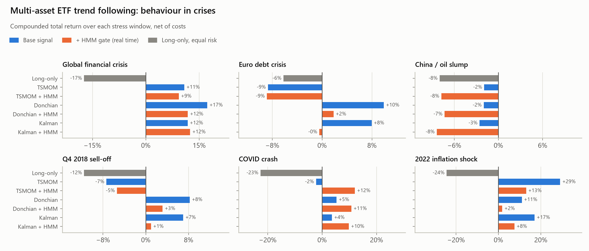
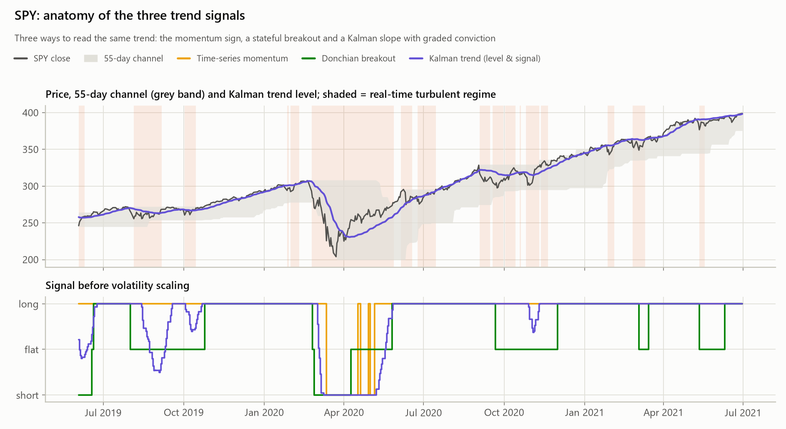

# Regime-Aware Trend Following

**Do hidden-Markov regime filters improve trend following once you take away the look-ahead?**

A common recipe in quant blogs and notebooks is to fit a Gaussian HMM to returns, label the states
"bull" and "bear", and only take trend trades that agree with the regime. The backtests look
excellent. This project tests the recipe properly:
- three trend signals (time-series momentum, Donchian breakout, and a Kalman local-linear trend);
- HMMs re-estimated monthly, walk-forward, with **filtered** (real-time) regime probabilities;
- a naive volatility-regime control;
- the same HMM fitted on the full sample, which *uses future data*, so the look-ahead bias can be measured directly;
- a paired block bootstrap to decide what is signal and what is noise.

It runs on an 18-ETF multi-asset universe (2005–2026) and on SPY alone (1996–2026).



---

## Key findings

1. **Look-ahead is the biggest "alpha" in the study.** The *same* HMM gate, fitted on the full sample and
   smoothed with future data, lifts the Sharpe ratio by **+0.42 to +0.54** in every one of the six
   signal/universe combinations (all with p < 0.001). Momentum on the ETF panel goes from 0.46 to **0.98**.
   Re-estimated monthly and filtered in real time, the edge disappears.
2. **Real-time HMM gates do not improve trend following.** Across 3 signals × 2 universes the
   Sharpe change ranges from **−0.14 to +0.08**, and none is statistically distinguishable from zero.
   This isn't caused by costs: at **zero** trading costs the HMM-gated and ungated multi-asset Sharpe ratios are
   0.61 vs 0.61 (momentum), 0.36 vs 0.30 (Donchian) and 0.42 vs 0.43 (Kalman).
3. **Why it fails: the real-time regime flickers, and it cuts off trend's right tail.** In real time
   the HMM switches regime 12–17 times a year, against 3–4 for the hindsight version. The gate also
   de-risks precisely in turbulent markets, where trend following earns its convex payoff. Monthly skew of the
   momentum book falls from **+0.25 to −0.24**, and its 2022 return from **+29% to +13%**.
4. **The HMM is a better regime classifier than a naive rule. It is still not a profitable filter.**
   It beats the "volatility above its median" gate by +0.13 to +0.23 Sharpe (p = 0.03–0.12).
   But the volatility gate itself is clearly harmful (−0.12 to −0.28), so "better than a bad filter"
   is not enough.
5. **Trend following does its job as a diversifier.** On the ETF panel the trend books have positive skew
   (+0.25 to +0.30, vs −0.80 for long-only). They made money in the GFC (+11% to +17%) and in 2022
   (+11% to +29%), when the long-only equal-risk book lost 17% and 25%. Their standalone Sharpe is not
   distinguishable from long-only.

## Results

### Multi-asset ETF panel (18 ETFs, Jul 2005 – Oct 2026, 5 bps costs)

| Strategy | Sharpe | CAGR | Vol | Max DD | Monthly skew | ΔSharpe vs base [95% CI] |
|:---|---:|---:|---:|---:|---:|:---|
| Long-only, equal risk | 0.39 | 5.3% | 10.3% | −26.3% | −0.80 | |
| **Time-series momentum** | **0.46** | 6.0% | 10.2% | −27.4% | +0.25 | |
| + HMM gate (real time) | 0.40 | 4.7% | 8.0% | −19.7% | −0.24 | −0.06 [−0.30, +0.20] |
| + volatility gate (control) | 0.18 | 2.9% | 8.0% | −16.7% | +0.26 | −0.28 [−0.56, +0.02] |
| + HMM gate (*look-ahead*) | *0.98* | *9.8%* | *8.1%* | *−14.1%* | *+0.06* | *+0.52 [+0.28, +0.76]* |
| **Donchian breakout** | **0.15** | 2.8% | 10.7% | −18.7% | +0.30 | |
| + HMM gate (real time) | 0.17 | 2.7% | 7.7% | −18.0% | +0.29 | +0.01 [−0.21, +0.23] |
| + volatility gate (control) | 0.04 | 1.7% | 8.4% | −19.9% | +0.35 | −0.12 [−0.35, +0.12] |
| + HMM gate (*look-ahead*) | *0.68* | *7.0%* | *8.0%* | *−13.7%* | *+0.39* | *+0.52 [+0.33, +0.72]* |
| **Kalman trend** | **0.33** | 4.7% | 10.5% | −17.7% | +0.30 | |
| + HMM gate (real time) | 0.26 | 3.5% | 7.8% | −18.4% | 0.00 | −0.07 [−0.29, +0.17] |
| + volatility gate (control) | 0.07 | 2.0% | 8.3% | −17.0% | +0.39 | −0.25 [−0.50, −0.01] |
| + HMM gate (*look-ahead*) | *0.84* | *8.4%* | *7.9%* | *−14.2%* | *+0.14* | *+0.51 [+0.30, +0.73]* |

*Italic rows use future data and could not have been traded.*



### Real-time vs. hindsight regimes



The filtered and smoothed regimes agree on about 89% of days. But the real-time classifier keeps
flipping on single large returns: a filtered probability *has* to react to today's return, because
it cannot see that tomorrow's return is calm. The hindsight version smooths these flips away using
data that did not exist yet. A gate built on it looks prescient by construction.

### Crisis behaviour



The gate's biggest cost is in exactly the episodes trend following is held for. In 2022 the momentum book
earned +29% ungated and +13% gated. In the Euro crisis the Donchian book earned +10% ungated and +2% gated.

### SPY single-asset case study (Mar 1996 – Oct 2026, 2 bps costs)

| Strategy | Sharpe | ΔSharpe HMM vs base [95% CI] | ΔSharpe look-ahead vs base [95% CI] |
|:---|---:|:---|:---|
| Long-only (vol-targeted) | 0.50 | | |
| Time-series momentum | 0.46 | −0.14 [−0.31, +0.03] | +0.44 [+0.25, +0.63] |
| Donchian breakout | −0.16 | +0.08 [−0.05, +0.21] | +0.42 [+0.29, +0.55] |
| Kalman trend | 0.15 | −0.02 [−0.16, +0.13] | +0.54 [+0.40, +0.70] |

On a single equity index, long/short trend following is a weak standalone strategy: equities trend upward and
shorts are expensive. It still made +28% in the dot-com bust and +15% in the GFC, when long-only lost 19% and 27%.
The regime conclusions are the same as on the ETF panel.

### Anatomy of the signals



COVID in one picture. The Kalman signal de-risks *gradually* as the slope turns. The breakout flips short on the
crash, steps back to flat, and is long again by June. The 12-month momentum sign whipsaws around zero several
times in spring 2020.
That whipsaw is the main source of turnover in naive trend rules (see *Limitations*).

Full auto-generated reports with every table, including turnover, crisis returns, per-asset regime
diagnostics, BIC model selection and cost sensitivity:
[`results/multi_asset/REPORT.md`](results/multi_asset/REPORT.md) ·
[`results/spy_case_study/REPORT.md`](results/spy_case_study/REPORT.md)

## Method in one screen

| Component | Choice |
|:---|:---|
| Signals | 12-month TSMOM sign; Donchian 55/20 **stateful** breakout; Kalman local-linear trend on log prices (from scratch), horizon-calibrated via the Hodrick–Prescott correspondence $q_\zeta = (2-2\cos(2\pi/P))^2$, $P$ = 126 days |
| Regime model | 2-state Gaussian HMM on daily log returns; rolling 10-year window; monthly re-estimation (warm start + random restart); **forward-filtered** probabilities between refits; states labelled by variance (calm / turbulent) |
| Gate | $g = s^+(1-p_{turb}) + s^-p_{turb}$: longs scale with P(calm), shorts with P(turbulent) |
| Sizing | Equal risk per live asset (EWMA vol), then a 10% ex-ante portfolio vol target from an EWMA covariance. **The scale is set by the ungated book**, so a gate can only remove risk, never re-lever |
| Execution | Close-to-next-day lag; 25% no-trade buffer; linear costs on traded notional; collateral earns T-bills |
| Inference | Paired circular block bootstrap (21-day blocks, 2,000 draws) on Sharpe differences |

Equations, design rationale and a table of the pitfalls this design avoids are in
[`docs/methodology.md`](docs/methodology.md).

## Engineering

- **Config-driven.** Each study is one YAML file ([`configs/`](configs)). The universe, signal
  horizons, HMM settings, sizing, costs and crisis windows are all declared there.
- **Fast and reproducible.** HMM fitting runs in parallel across assets, and the fitted regimes are
  cached under a hash of the data and model settings. The first run takes about 7 minutes; reruns take about 20 seconds.
  Market data is cached locally and every random draw is seeded.
- **Tested.** 27 tests on synthetic data, with no network access needed:
  - the Kalman filter recovers a known trend and is causal;
  - the Donchian channel excludes the current bar;
  - the forward filter matches hmmlearn's forward-backward output to 1e-8;
  - the walk-forward HMM recovers simulated Markov-switching regimes with more than 85% accuracy;
  - **rewriting future returns changes no past regime probability**;
  - the volatility target is hit exactly, and the lag, cost and no-trade buffer accounting is checked by hand.
- **Data hygiene.** Unbalanced panel (assets join when they have history), stale-price masking,
  gap filling only after inception.

```
regime-aware-trend-following/
├── configs/                  # multi_asset.yaml, spy_case_study.yaml
├── src/regime_trend/
│   ├── data.py               # OHLC + T-bill download, cache, hygiene, unbalanced panel
│   ├── kalman.py             # local-linear-trend Kalman filter (from scratch)
│   ├── signals.py            # TSMOM, stateful Donchian, Kalman trend signal
│   ├── regimes.py            # walk-forward HMM, forward filter, vol control, look-ahead benchmark
│   ├── portfolio.py          # gating, unit-risk weights, ex-ante vol targeting, buffer, P&L
│   ├── metrics.py            # performance, crisis windows, paired block bootstrap
│   ├── plotting.py           # one consistent visual system
│   ├── experiments.py        # the research pipeline
│   └── cli.py                # `regime-trend run ...`
├── tests/                    # synthetic-data unit tests
├── results/<study>/          # REPORT.md, CSV tables, figures/
└── docs/methodology.md
```

## Reproduce

```bash
python -m venv .venv
source .venv/bin/activate          # Windows: .venv\Scripts\activate
pip install -e ".[dev]"

pytest                             # ~1 min, offline
regime-trend run configs/multi_asset.yaml configs/spy_case_study.yaml
```

## Limitations and what I would try next

- **Turnover is high on notional.** The 10% vol target levers low-volatility bond ETFs (average gross
  leverage about 2×), and naive trend rules flip often: the 12-month momentum sign whipsaws about 6 times per
  asset per year. Costs are therefore a first-order input, and the cost-sensitivity tables are part of the
  result. Continuous signals and slower rebalancing would cut turnover. They would not change the regime
  conclusion, which already holds at zero cost.
- **ETFs stand in for futures.** Leveraged and short ETF positions are financed at the T-bill rate
  (futures-style accounting); borrow costs and margin are ignored.
- **One regime specification.** The HMM is univariate per asset with Gaussian emissions. Untested
  alternatives include sticky or duration-dependent models (HSMMs), weekly observations, cross-asset
  (market-wide) regimes, or using the regime probability to *blend* signals rather than gate them.
- **No tuning, by design.** Signal horizons and HMM settings are textbook values chosen before seeing
  results. With 15 paired comparisons per universe, nothing here should be read as significant without a
  multiple-testing adjustment, and that would strengthen the null result for real-time gates.
- **Early sample is thin.** The ETF panel starts in 2005 with four live assets; all 18 are live from 2010.

## References

Hamilton (1989) · Rabiner (1989) · Harvey (1989) · Moskowitz, Ooi & Pedersen (2012) ·
Ang & Timmermann (2012) · Hurst, Ooi & Pedersen (2017) · Nystrup, Madsen & Lindström (2017) ·
Politis & Romano (1992). Full citations are in [`docs/methodology.md`](docs/methodology.md#references).

## License

MIT. See [LICENSE](LICENSE).
