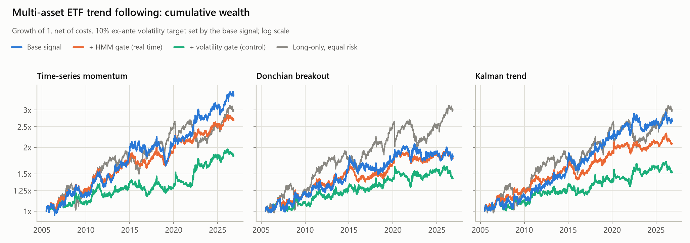
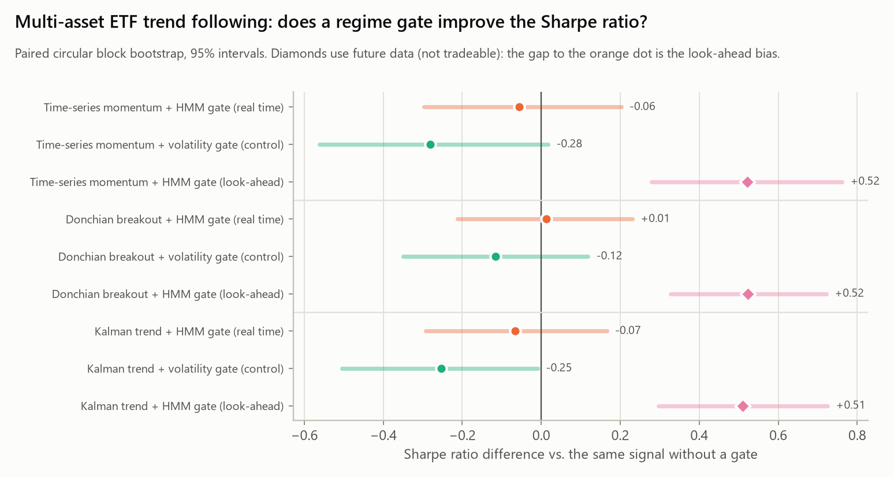
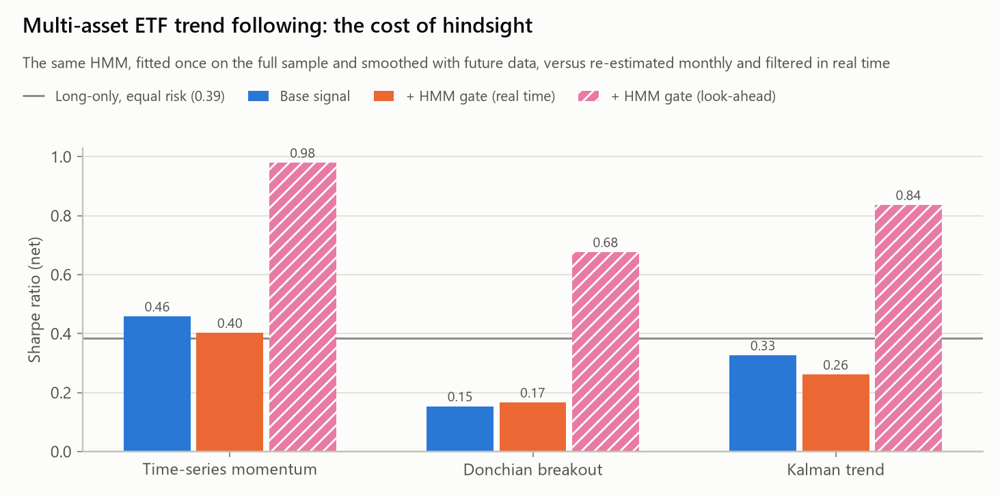
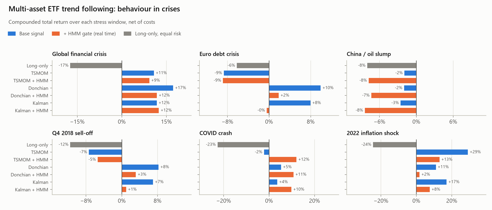
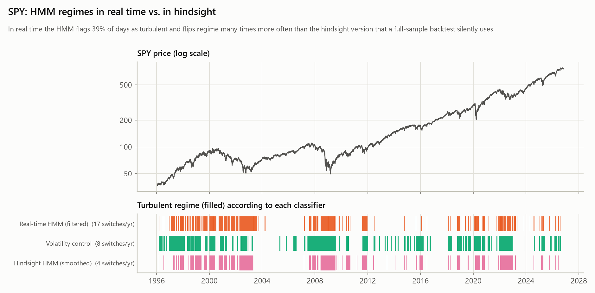
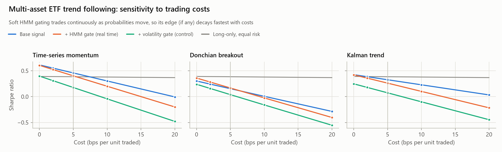
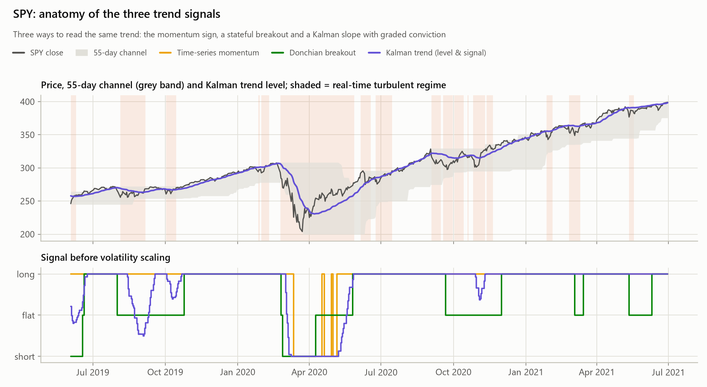

# Multi-asset ETF trend following - results

_Auto-generated by `regime-trend run configs/multi_asset.yaml`._

* Evaluation period: **2005-07-01 -> 2026-10-30**; live assets 4-18 (unbalanced panel)
* HMM: 2 states on return; 2520-day rolling window, refit every 21 days, filtered probabilities
* Sizing: 10% ex-ante vol target set by each base signal; costs 5 bps per unit traded

## Performance (net of costs)

| | CAGR | Volatility | Sharpe | Sortino | Max drawdown | Calmar | Skew (monthly) |
|:---|---:|---:|---:|---:|---:|---:|---:|
| Long-only, equal risk | 5.3% | 10.3% | 0.39 | 0.53 | -26.3% | 0.20 | -0.80 |
| Time-series momentum | 6.0% | 10.2% | 0.46 | 0.63 | -27.4% | 0.22 | 0.25 |
| Time-series momentum + HMM gate | 4.7% | 8.0% | 0.40 | 0.56 | -19.7% | 0.24 | -0.24 |
| Time-series momentum + vol gate | 2.9% | 8.0% | 0.18 | 0.25 | -16.7% | 0.17 | 0.26 |
| Time-series momentum + HMM gate (look-ahead) | 9.8% | 8.1% | 0.98 | 1.42 | -14.1% | 0.69 | 0.06 |
| Donchian breakout | 2.8% | 10.7% | 0.15 | 0.21 | -18.7% | 0.15 | 0.30 |
| Donchian breakout + HMM gate | 2.7% | 7.7% | 0.17 | 0.23 | -18.0% | 0.15 | 0.28 |
| Donchian breakout + vol gate | 1.7% | 8.4% | 0.04 | 0.05 | -19.9% | 0.09 | 0.35 |
| Donchian breakout + HMM gate (look-ahead) | 7.0% | 8.0% | 0.68 | 0.97 | -13.7% | 0.51 | 0.39 |
| Kalman trend | 4.7% | 10.5% | 0.33 | 0.46 | -17.7% | 0.27 | 0.30 |
| Kalman trend + HMM gate | 3.5% | 7.8% | 0.26 | 0.36 | -18.4% | 0.19 | -0.00 |
| Kalman trend + vol gate | 2.0% | 8.3% | 0.07 | 0.10 | -17.0% | 0.12 | 0.39 |
| Kalman trend + HMM gate (look-ahead) | 8.4% | 7.9% | 0.84 | 1.21 | -14.2% | 0.59 | 0.14 |

## Trading profile

| | Avg gross leverage | Time invested | Turnover (1-way, p.a.) |
|:---|---:|---:|---:|
| Long-only, equal risk | 1.83 | 100.0% | 56.6% |
| Time-series momentum | 2.25 | 100.0% | 1577.6% |
| Time-series momentum + HMM gate | 1.46 | 100.0% | 1611.3% |
| Time-series momentum + vol gate | 1.33 | 98.6% | 1761.4% |
| Time-series momentum + HMM gate (look-ahead) | 1.51 | 100.0% | 1067.5% |
| Donchian breakout | 1.80 | 100.0% | 1578.6% |
| Donchian breakout + HMM gate | 1.15 | 100.0% | 1484.7% |
| Donchian breakout + vol gate | 1.13 | 97.9% | 1668.9% |
| Donchian breakout + HMM gate (look-ahead) | 1.18 | 99.8% | 1124.1% |
| Kalman trend | 2.09 | 100.0% | 1026.2% |
| Kalman trend + HMM gate | 1.29 | 100.0% | 1241.8% |
| Kalman trend + vol gate | 1.28 | 99.5% | 1442.7% |
| Kalman trend + HMM gate (look-ahead) | 1.32 | 100.0% | 771.1% |

## Do the gates help? Paired block-bootstrap Sharpe differences

| | dSharpe | CI low | CI high | p (dSharpe <= 0) |
|:---|---:|---:|---:|---:|
| Time-series momentum + HMM gate vs Time-series momentum | -0.06 | -0.30 | 0.20 | 0.67 |
| Time-series momentum + vol gate vs Time-series momentum | -0.28 | -0.56 | 0.02 | 0.96 |
| Time-series momentum + HMM gate (look-ahead) vs Time-series momentum | 0.52 | 0.28 | 0.76 | 0.00 |
| Time-series momentum + HMM gate vs Time-series momentum + vol gate | 0.23 | -0.01 | 0.46 | 0.03 |
| Time-series momentum vs Long-only, equal risk | 0.07 | -0.46 | 0.56 | 0.41 |
| Donchian breakout + HMM gate vs Donchian breakout | 0.01 | -0.21 | 0.23 | 0.45 |
| Donchian breakout + vol gate vs Donchian breakout | -0.12 | -0.35 | 0.12 | 0.84 |
| Donchian breakout + HMM gate (look-ahead) vs Donchian breakout | 0.52 | 0.33 | 0.72 | 0.00 |
| Donchian breakout + HMM gate vs Donchian breakout + vol gate | 0.13 | -0.09 | 0.36 | 0.12 |
| Donchian breakout vs Long-only, equal risk | -0.23 | -0.83 | 0.37 | 0.80 |
| Kalman trend + HMM gate vs Kalman trend | -0.07 | -0.29 | 0.17 | 0.70 |
| Kalman trend + vol gate vs Kalman trend | -0.25 | -0.50 | -0.01 | 0.98 |
| Kalman trend + HMM gate (look-ahead) vs Kalman trend | 0.51 | 0.30 | 0.73 | 0.00 |
| Kalman trend + HMM gate vs Kalman trend + vol gate | 0.19 | -0.04 | 0.41 | 0.05 |
| Kalman trend vs Long-only, equal risk | -0.06 | -0.65 | 0.52 | 0.59 |

Sharpe ratios with 95% intervals:

| | Sharpe | CI low | CI high |
|:---|---:|---:|---:|
| Long-only, equal risk | 0.39 | -0.06 | 0.86 |
| Time-series momentum | 0.46 | 0.04 | 0.87 |
| Time-series momentum + HMM gate | 0.40 | -0.01 | 0.80 |
| Time-series momentum + vol gate | 0.18 | -0.22 | 0.57 |
| Time-series momentum + HMM gate (look-ahead) | 0.98 | 0.59 | 1.36 |
| Donchian breakout | 0.15 | -0.20 | 0.53 |
| Donchian breakout + HMM gate | 0.17 | -0.19 | 0.54 |
| Donchian breakout + vol gate | 0.04 | -0.30 | 0.40 |
| Donchian breakout + HMM gate (look-ahead) | 0.68 | 0.32 | 1.04 |
| Kalman trend | 0.33 | -0.04 | 0.69 |
| Kalman trend + HMM gate | 0.26 | -0.12 | 0.65 |
| Kalman trend + vol gate | 0.07 | -0.30 | 0.44 |
| Kalman trend + HMM gate (look-ahead) | 0.84 | 0.48 | 1.20 |

## Look-ahead bias

## Crisis behaviour (compounded total return)

| | Global financial crisis | Euro debt crisis | China / oil slump | Q4 2018 sell-off | COVID crash | 2022 inflation shock |
|:---|---:|---:|---:|---:|---:|---:|
| Long-only, equal risk | -17.3% | -6.2% | -8.0% | -11.5% | -22.7% | -24.5% |
| Time-series momentum | 10.8% | -8.7% | -1.9% | -7.4% | -2.2% | 29.1% |
| Time-series momentum + HMM gate | 9.3% | -8.9% | -7.8% | -5.4% | 12.0% | 13.1% |
| Time-series momentum + vol gate | 12.8% | -6.7% | 1.6% | 1.0% | 14.1% | 34.1% |
| Time-series momentum + HMM gate (look-ahead) | 13.6% | -2.4% | -0.8% | -3.4% | 11.3% | 23.7% |
| Donchian breakout | 17.3% | 9.9% | -2.0% | 8.2% | 5.3% | 11.0% |
| Donchian breakout + HMM gate | 11.8% | 1.8% | -7.3% | 3.1% | 10.7% | 1.8% |
| Donchian breakout + vol gate | 11.9% | 3.0% | 4.3% | 8.2% | 11.5% | 16.5% |
| Donchian breakout + HMM gate (look-ahead) | 16.4% | 5.2% | -1.1% | 5.5% | 10.4% | 11.1% |
| Kalman trend | 11.8% | 7.9% | -2.6% | 7.0% | 3.6% | 17.0% |
| Kalman trend + HMM gate | 12.5% | -0.5% | -8.4% | 1.0% | 9.8% | 7.5% |
| Kalman trend + vol gate | 14.4% | 1.4% | 1.0% | 7.2% | 12.1% | 25.2% |
| Kalman trend + HMM gate (look-ahead) | 17.6% | 5.9% | -2.1% | 3.2% | 9.6% | 17.6% |

## Regime diagnostics (evaluation period)

| | Share turbulent | Switches / yr (HMM real time) | Switches / yr (HMM hindsight) | Switches / yr (vol control) | Agreement with hindsight | Calm vol | Turbulent vol | Calm duration (days) | Turbulent duration (days) |
|:---|---:|---:|---:|---:|---:|---:|---:|---:|---:|
| SPY | 28.7% | 14.6 | 4.1 | 7.8 | 89.9% | 11.3% | 29.6% | 80.1 | 31.5 |
| QQQ | 24.7% | 12.9 | 2.5 | 9.3 | 90.4% | 14.8% | 35.9% | 166.8 | 44.6 |
| IWM | 22.5% | 11.5 | 2.6 | 9.1 | 88.9% | 16.8% | 43.6% | 174.6 | 44.8 |
| EFA | 20.0% | 14.1 | 3.4 | 11.1 | 88.6% | 13.8% | 36.0% | 92.4 | 22.6 |
| EEM | 17.2% | 10.0 | 2.9 | 9.0 | 93.4% | 17.7% | 43.8% | 102.1 | 29.4 |
| VNQ | 20.2% | 8.6 | 2.5 | 9.9 | 95.3% | 14.7% | 60.9% | 143.2 | 67.4 |
| TLT | 37.4% | 10.0 | 2.2 | 8.2 | 83.0% | 10.0% | 19.0% | 153.6 | 76.2 |
| IEF | 35.1% | 9.3 | 2.0 | 7.5 | 89.9% | 4.8% | 9.1% | 134.3 | 83.7 |
| TIP | 18.7% | 7.8 | 1.9 | 9.1 | 92.7% | 4.7% | 11.0% | 194.7 | 49.0 |
| LQD | 14.9% | 7.6 | 3.4 | 8.6 | 89.5% | 5.2% | 28.8% | 151.3 | 7.2 |
| HYG | 14.5% | 13.4 | 4.1 | 5.8 | 91.5% | 5.0% | 24.2% | 46.4 | 14.3 |
| GLD | 29.1% | 18.0 | 3.1 | 9.7 | 86.4% | 13.3% | 29.0% | 83.0 | 37.9 |
| SLV | 13.8% | 25.1 | 4.3 | 10.5 | 86.8% | 22.7% | 58.4% | 45.5 | 10.2 |
| DBC | 28.7% | 11.9 | 4.0 | 9.2 | 78.4% | 13.7% | 29.7% | 60.6 | 33.9 |
| USO | 20.4% | 12.4 | 3.8 | 8.2 | 88.1% | 24.7% | 69.7% | 108.6 | 33.8 |
| UUP | 12.5% | 7.5 | 3.0 | 10.9 | 83.6% | 6.2% | 12.2% | 118.7 | 40.6 |
| FXE | 26.0% | 8.1 | 1.5 | 10.0 | 83.2% | 7.6% | 13.8% | 217.9 | 109.8 |
| FXY | 26.1% | 15.9 | 7.3 | 8.4 | 81.9% | 7.4% | 15.4% | 43.6 | 23.2 |

Model selection on SPY (full sample, in-sample):

| | log-likelihood | BIC | dBIC vs best |
|:---|---:|---:|---:|
| 1 | -12055.3 | 24128.7 | 4005.9 |
| 2 | -10425.6 | 20914.6 | 791.8 |
| 3 | -10049.1 | 20224.8 | 102.0 |
| 4 | -9957.3 | 20122.8 | 0.0 |

## Cost sensitivity (Sharpe)

| | 0 bps | 2 bps | 5 bps | 10 bps | 20 bps |
|:---|---:|---:|---:|---:|---:|
| Long-only, equal risk | 0.39 | 0.39 | 0.39 | 0.38 | 0.37 |
| Time-series momentum | 0.61 | 0.55 | 0.46 | 0.30 | -0.01 |
| Time-series momentum + HMM gate | 0.61 | 0.52 | 0.40 | 0.20 | -0.20 |
| Time-series momentum + vol gate | 0.40 | 0.31 | 0.18 | -0.04 | -0.48 |
| Time-series momentum + HMM gate (look-ahead) | 1.11 | 1.06 | 0.98 | 0.85 | 0.58 |
| Donchian breakout | 0.30 | 0.24 | 0.15 | 0.01 | -0.29 |
| Donchian breakout + HMM gate | 0.36 | 0.28 | 0.17 | -0.02 | -0.40 |
| Donchian breakout + vol gate | 0.24 | 0.16 | 0.04 | -0.16 | -0.55 |
| Donchian breakout + HMM gate (look-ahead) | 0.82 | 0.76 | 0.68 | 0.53 | 0.25 |
| Kalman trend | 0.43 | 0.39 | 0.33 | 0.23 | 0.03 |
| Kalman trend + HMM gate | 0.42 | 0.36 | 0.26 | 0.10 | -0.22 |
| Kalman trend + vol gate | 0.25 | 0.18 | 0.07 | -0.10 | -0.45 |
| Kalman trend + HMM gate (look-ahead) | 0.93 | 0.90 | 0.84 | 0.74 | 0.54 |

