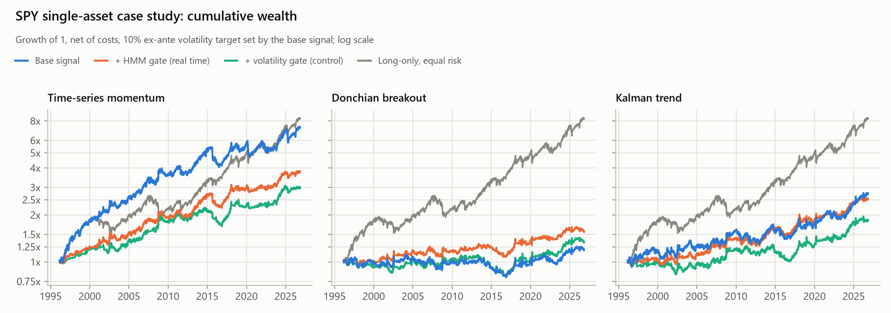
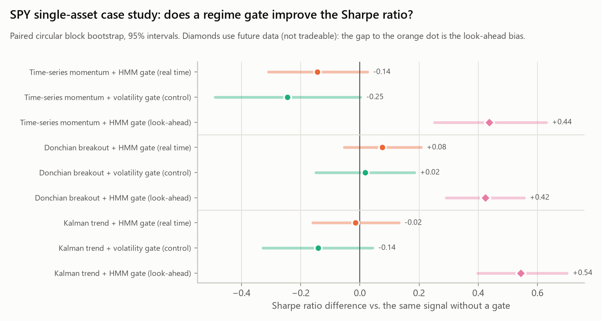
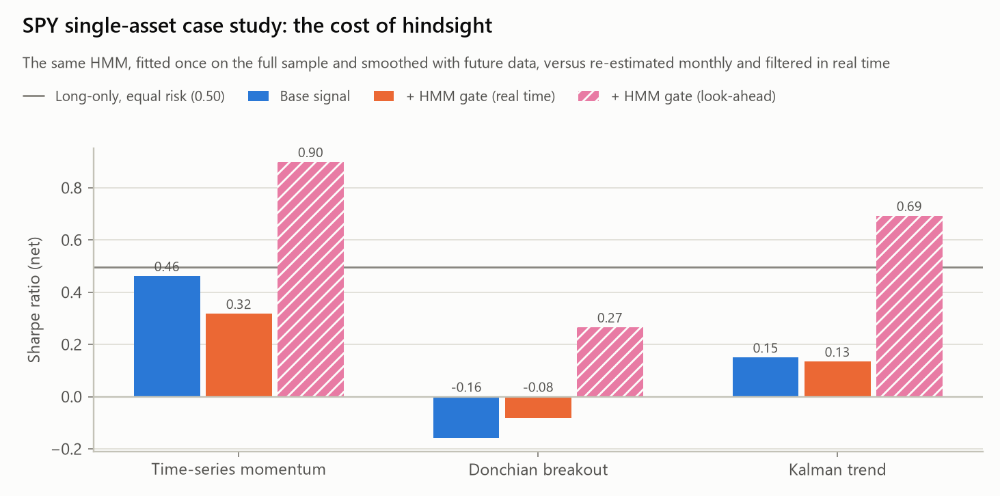
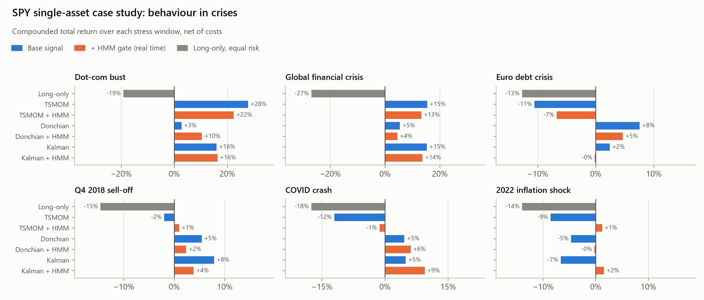
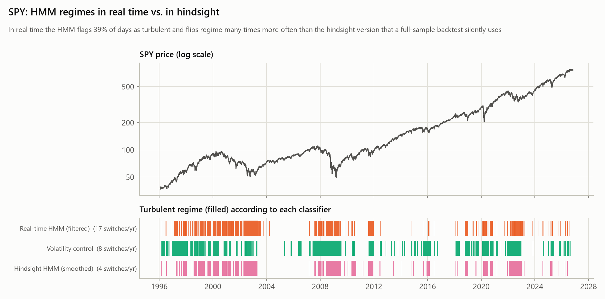
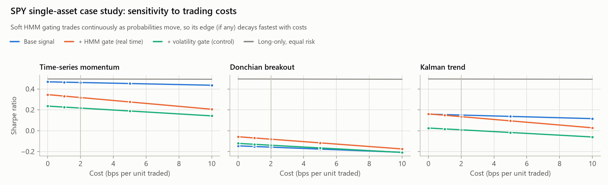
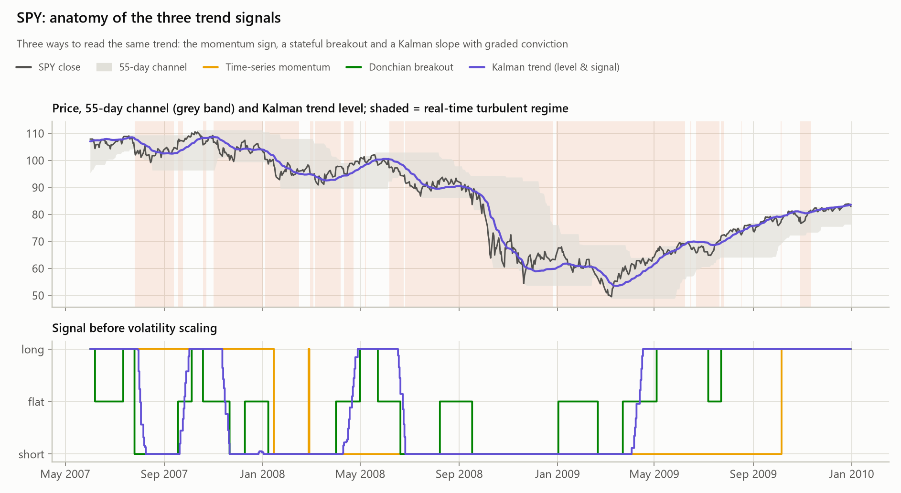

# SPY single-asset case study - results

_Auto-generated by `regime-trend run configs/spy_case_study.yaml`._

* Evaluation period: **1996-03-01 -> 2026-10-30**; live assets 1-1 (unbalanced panel)
* HMM: 2 states on return; 2520-day rolling window, refit every 21 days, filtered probabilities
* Sizing: 10% ex-ante vol target set by each base signal; costs 2 bps per unit traded

## Performance (net of costs)

| | CAGR | Volatility | Sharpe | Sortino | Max drawdown | Calmar | Skew (monthly) |
|:---|---:|---:|---:|---:|---:|---:|---:|
| Long-only, equal risk | 7.1% | 10.5% | 0.50 | 0.68 | -27.6% | 0.26 | -0.53 |
| Time-series momentum | 6.7% | 10.2% | 0.46 | 0.63 | -25.6% | 0.26 | -0.65 |
| Time-series momentum + HMM gate | 4.4% | 7.4% | 0.32 | 0.43 | -19.3% | 0.23 | -0.34 |
| Time-series momentum + vol gate | 3.6% | 7.2% | 0.22 | 0.29 | -24.1% | 0.15 | 0.30 |
| Time-series momentum + HMM gate (look-ahead) | 9.1% | 7.5% | 0.90 | 1.27 | -10.2% | 0.89 | 0.07 |
| Donchian breakout | 0.6% | 8.5% | -0.16 | -0.21 | -28.1% | 0.02 | 0.07 |
| Donchian breakout + HMM gate | 1.4% | 7.0% | -0.08 | -0.11 | -17.7% | 0.08 | 0.43 |
| Donchian breakout + vol gate | 0.9% | 7.5% | -0.14 | -0.19 | -26.9% | 0.03 | 0.40 |
| Donchian breakout + HMM gate (look-ahead) | 4.0% | 7.3% | 0.27 | 0.38 | -11.5% | 0.35 | 0.60 |
| Kalman trend | 3.3% | 10.2% | 0.15 | 0.21 | -19.8% | 0.17 | -0.15 |
| Kalman trend + HMM gate | 3.0% | 7.9% | 0.13 | 0.18 | -13.2% | 0.23 | 0.19 |
| Kalman trend + vol gate | 2.0% | 8.4% | 0.01 | 0.01 | -22.1% | 0.09 | 0.27 |
| Kalman trend + HMM gate (look-ahead) | 7.9% | 8.3% | 0.69 | 1.00 | -11.4% | 0.70 | 0.27 |

## Trading profile

| | Avg gross leverage | Time invested | Turnover (1-way, p.a.) |
|:---|---:|---:|---:|
| Long-only, equal risk | 0.63 | 100.0% | 12.6% |
| Time-series momentum | 0.62 | 100.0% | 162.6% |
| Time-series momentum + HMM gate | 0.46 | 97.2% | 512.1% |
| Time-series momentum + vol gate | 0.38 | 59.7% | 333.8% |
| Time-series momentum + HMM gate (look-ahead) | 0.48 | 95.3% | 191.9% |
| Donchian breakout | 0.43 | 67.4% | 266.7% |
| Donchian breakout + HMM gate | 0.33 | 66.7% | 412.4% |
| Donchian breakout + vol gate | 0.34 | 50.7% | 328.8% |
| Donchian breakout + HMM gate (look-ahead) | 0.35 | 65.5% | 246.9% |
| Kalman trend | 0.62 | 100.0% | 218.8% |
| Kalman trend + HMM gate | 0.45 | 98.2% | 529.4% |
| Kalman trend + vol gate | 0.44 | 68.0% | 361.1% |
| Kalman trend + HMM gate (look-ahead) | 0.48 | 95.7% | 219.6% |

## Do the gates help? Paired block-bootstrap Sharpe differences

| | dSharpe | CI low | CI high | p (dSharpe <= 0) |
|:---|---:|---:|---:|---:|
| Time-series momentum + HMM gate vs Time-series momentum | -0.14 | -0.31 | 0.03 | 0.95 |
| Time-series momentum + vol gate vs Time-series momentum | -0.25 | -0.49 | 0.00 | 0.97 |
| Time-series momentum + HMM gate (look-ahead) vs Time-series momentum | 0.44 | 0.25 | 0.63 | 0.00 |
| Time-series momentum + HMM gate vs Time-series momentum + vol gate | 0.10 | -0.08 | 0.28 | 0.14 |
| Time-series momentum vs Long-only, equal risk | -0.03 | -0.33 | 0.28 | 0.59 |
| Donchian breakout + HMM gate vs Donchian breakout | 0.08 | -0.05 | 0.21 | 0.14 |
| Donchian breakout + vol gate vs Donchian breakout | 0.02 | -0.15 | 0.18 | 0.41 |
| Donchian breakout + HMM gate (look-ahead) vs Donchian breakout | 0.42 | 0.29 | 0.55 | 0.00 |
| Donchian breakout + HMM gate vs Donchian breakout + vol gate | 0.06 | -0.09 | 0.21 | 0.23 |
| Donchian breakout vs Long-only, equal risk | -0.65 | -1.12 | -0.21 | 1.00 |
| Kalman trend + HMM gate vs Kalman trend | -0.02 | -0.16 | 0.13 | 0.60 |
| Kalman trend + vol gate vs Kalman trend | -0.14 | -0.33 | 0.04 | 0.93 |
| Kalman trend + HMM gate (look-ahead) vs Kalman trend | 0.54 | 0.40 | 0.70 | 0.00 |
| Kalman trend + HMM gate vs Kalman trend + vol gate | 0.13 | -0.05 | 0.29 | 0.07 |
| Kalman trend vs Long-only, equal risk | -0.35 | -0.76 | 0.07 | 0.94 |

Sharpe ratios with 95% intervals:

| | Sharpe | CI low | CI high |
|:---|---:|---:|---:|
| Long-only, equal risk | 0.50 | 0.17 | 0.84 |
| Time-series momentum | 0.46 | 0.12 | 0.82 |
| Time-series momentum + HMM gate | 0.32 | 0.00 | 0.67 |
| Time-series momentum + vol gate | 0.22 | -0.11 | 0.55 |
| Time-series momentum + HMM gate (look-ahead) | 0.90 | 0.59 | 1.22 |
| Donchian breakout | -0.16 | -0.48 | 0.16 |
| Donchian breakout + HMM gate | -0.08 | -0.39 | 0.23 |
| Donchian breakout + vol gate | -0.14 | -0.46 | 0.17 |
| Donchian breakout + HMM gate (look-ahead) | 0.27 | -0.03 | 0.56 |
| Kalman trend | 0.15 | -0.16 | 0.46 |
| Kalman trend + HMM gate | 0.13 | -0.17 | 0.44 |
| Kalman trend + vol gate | 0.01 | -0.29 | 0.31 |
| Kalman trend + HMM gate (look-ahead) | 0.69 | 0.41 | 0.98 |

## Look-ahead bias

## Crisis behaviour (compounded total return)

| | Dot-com bust | Global financial crisis | Euro debt crisis | Q4 2018 sell-off | COVID crash | 2022 inflation shock |
|:---|---:|---:|---:|---:|---:|---:|
| Long-only, equal risk | -19.2% | -27.0% | -12.7% | -14.6% | -17.5% | -14.0% |
| Time-series momentum | 27.8% | 15.4% | -10.6% | -2.0% | -12.1% | -8.6% |
| Time-series momentum + HMM gate | 22.4% | 13.2% | -6.7% | 1.0% | -1.3% | 1.2% |
| Time-series momentum + vol gate | 9.0% | 25.8% | -6.9% | 3.4% | 2.8% | 5.6% |
| Time-series momentum + HMM gate (look-ahead) | 30.6% | 21.9% | -1.5% | 4.1% | 1.1% | 3.0% |
| Donchian breakout | 2.7% | 5.4% | 7.5% | 5.4% | 4.6% | -4.7% |
| Donchian breakout + HMM gate | 10.4% | 4.5% | 4.7% | 2.3% | 6.1% | -0.2% |
| Donchian breakout + vol gate | 0.1% | 9.4% | 4.0% | 6.1% | 10.2% | 2.9% |
| Donchian breakout + HMM gate (look-ahead) | 8.4% | 7.1% | 7.5% | 6.7% | 8.5% | 0.1% |
| Kalman trend | 15.9% | 15.3% | 2.4% | 7.9% | 4.9% | -6.7% |
| Kalman trend + HMM gate | 16.3% | 13.7% | -0.2% | 3.8% | 9.4% | 1.6% |
| Kalman trend + vol gate | 3.3% | 23.3% | -1.0% | 9.3% | 13.1% | 6.7% |
| Kalman trend + HMM gate (look-ahead) | 23.7% | 22.2% | 6.0% | 10.2% | 11.5% | 3.4% |

## Regime diagnostics (evaluation period)

| | Share turbulent | Switches / yr (HMM real time) | Switches / yr (HMM hindsight) | Switches / yr (vol control) | Agreement with hindsight | Calm vol | Turbulent vol | Calm duration (days) | Turbulent duration (days) |
|:---|---:|---:|---:|---:|---:|---:|---:|---:|---:|
| SPY | 38.8% | 16.9 | 4.1 | 7.9 | 87.1% | 9.8% | 27.2% | 54.2 | 33.6 |

Model selection on SPY (full sample, in-sample):

| | log-likelihood | BIC | dBIC vs best |
|:---|---:|---:|---:|
| 1 | -12055.3 | 24128.7 | 4005.6 |
| 2 | -10425.6 | 20914.6 | 791.5 |
| 3 | -10049.1 | 20224.8 | 101.7 |
| 4 | -9957.5 | 20123.1 | 0.0 |

## Cost sensitivity (Sharpe)

| | 0 bps | 1 bps | 2 bps | 5 bps | 10 bps |
|:---|---:|---:|---:|---:|---:|
| Long-only, equal risk | 0.50 | 0.50 | 0.50 | 0.49 | 0.49 |
| Time-series momentum | 0.47 | 0.47 | 0.46 | 0.45 | 0.44 |
| Time-series momentum + HMM gate | 0.35 | 0.33 | 0.32 | 0.28 | 0.21 |
| Time-series momentum + vol gate | 0.24 | 0.23 | 0.22 | 0.19 | 0.14 |
| Time-series momentum + HMM gate (look-ahead) | 0.91 | 0.90 | 0.90 | 0.88 | 0.86 |
| Donchian breakout | -0.15 | -0.15 | -0.16 | -0.18 | -0.21 |
| Donchian breakout + HMM gate | -0.06 | -0.07 | -0.08 | -0.12 | -0.17 |
| Donchian breakout + vol gate | -0.12 | -0.13 | -0.14 | -0.17 | -0.21 |
| Donchian breakout + HMM gate (look-ahead) | 0.28 | 0.27 | 0.27 | 0.25 | 0.21 |
| Kalman trend | 0.16 | 0.15 | 0.15 | 0.14 | 0.12 |
| Kalman trend + HMM gate | 0.16 | 0.15 | 0.13 | 0.09 | 0.03 |
| Kalman trend + vol gate | 0.03 | 0.02 | 0.01 | -0.02 | -0.06 |
| Kalman trend + HMM gate (look-ahead) | 0.70 | 0.70 | 0.69 | 0.68 | 0.65 |

